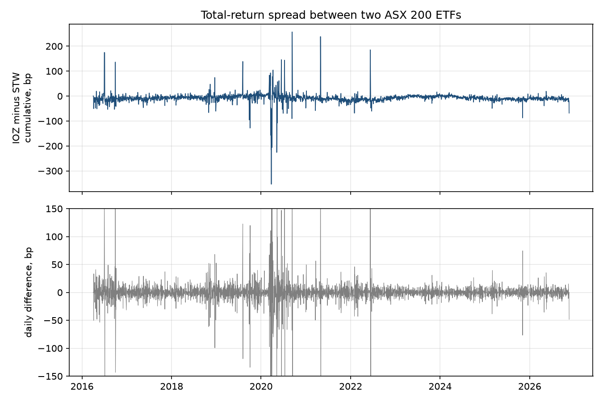
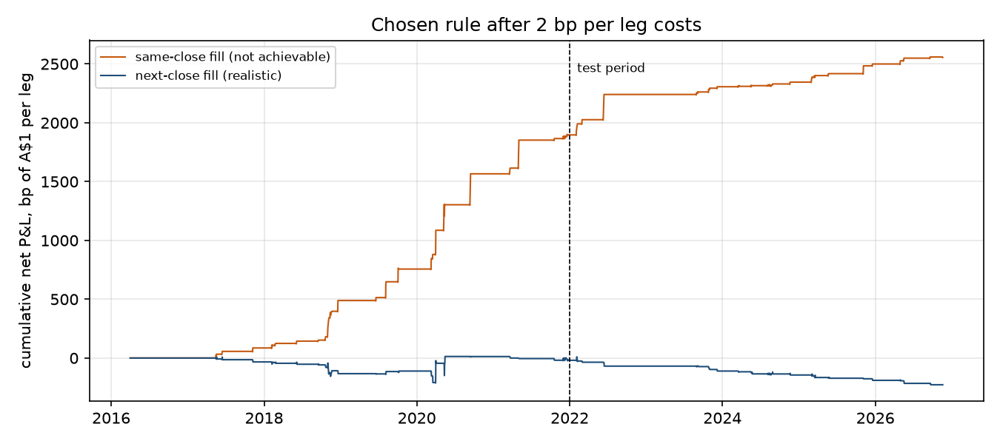

# IOZ vs STW pairs backtest

IOZ and STW both track the ASX 200, so their total returns should be almost identical. I wanted to see if the small gaps between their daily closing prices could be traded with a simple mean-reversion rule after costs.

**Short answer: no, not with daily data.**

## What I found

- The gaps are small (median about 6bp a day) and close quickly. Roughly half of a day's gap reverses by the next close (lag-1 autocorrelation −0.47, half-life about half a day).
- I tested 12 versions of the rule on 2016–2021. All of them lost money after costs. The least bad one (120-day z-score, enter at |z| > 2.5) lost 42bp a year when I ran it once on 2022–2026 (Sharpe −1.0). It lost money even before costs.
- If you trade at the same close the signal comes from, it looks great: +134bp a year (Sharpe 1.2). But that's look-ahead, since you can't know the closing price until the close has happened.
- So the edge, if there is one, is intraday. Daily closes are too slow to capture it.




## Data

Daily closes and dividends from Yahoo Finance (Jan 2015 to Nov 2026). A few fixes were needed:

- Yahoo is missing some early STW dividends, so the study starts in April 2016.
- One STW dividend in Sep 2024 is listed twice, so I removed the duplicate.
- Yahoo's ex-dates are sometimes a day or two off, which creates fake jumps in the spread. The rule stays flat for 3 trading days either side of each ex-date (about 18% of days).
- 63 days had gaps over 50bp. They're listed in `results/days_over_50bp.csv`, and many are from March–June 2020.

## Method

- Spread = log(IOZ total return) − log(STW total return)
- z-score over the last L days, using only data up to that day
- Enter when |z| > k, exit when z crosses 0
- Trade at the next close after the signal (one-day lag)
- Costs: 2bp per leg each way
- Picked L ∈ {20, 60, 120} and k ∈ {1.0, 1.5, 2.0, 2.5} on 2016–2021 by Sharpe, then tested once on 2022–2026

## Results (chosen rule, test period 2022–2026)

| Version | Net return (bp/yr) | Sharpe |
|---|---|---|
| Next-close fill (realistic) | −42.4 | −1.04 |
| Same-close fill (look-ahead) | +134.4 | 1.16 |
| Next-close fill, no dividend blackout | −46.0 | −1.04 |

Full tables are in `results/summary.md`.

## Limitations

- Closing prices only, with no bid/ask or intraday data
- Flat cost assumption, and borrow costs for shorting are ignored
- Only about 47 trades in total, so the results aren't statistically strong either way

## Ideas for next time

- Use intraday quotes and each fund's indicative NAV
- Compare each ETF with SPI 200 futures instead

## Running it

```bash
pip install -r requirements.txt
python run_all.py      # writes results/
python -m pytest       # 15 tests
```